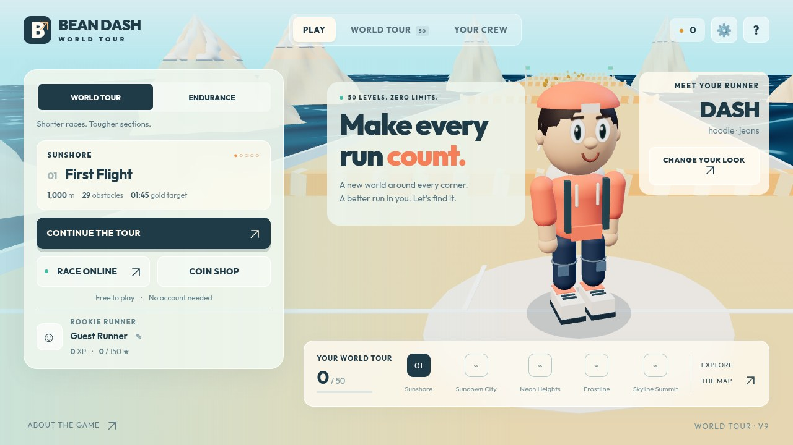

# Bean Dash Online

[](https://github.com/IntelliCoder-AI/bean-dash-online/actions/workflows/test.yml)

[Play on Vercel](https://bean-dash-online.vercel.app/) · [Play on Render](https://bean-dash-online.onrender.com/) · [Player guide](docs/GAME_GUIDE.md) · [Game checks](.github/workflows/test.yml)

A multiplayer 3D obstacle racer for friends. Join a private room with a six-character code, dodge moving hazards, and race for a place at the finish. No player account or installation required.



- **World Tour:** 50 courses, checkpoints, medals and separate Hardcore records.
- **Endurance:** longer courses reaching 60 km, with solo checkpoint revivals.
- **Your runner:** four characters, modular clothing, cosmetics and a coin shop.
- **Fair online races:** up to 16 runners; labeled bots fill empty places. Purchased powers and revivals are solo only.

## Play with friends

1. Open the game and choose **Race Online → Generate Room Code**.
2. Friends open the same game, choose **Race Online**, enter the code and select **Join by Code**.
3. Once at least two people have joined, the host selects **Start Race**.

Jump gaps, avoid dangerous moving hazards and clear solid barriers. The first runners across the finish qualify: 12 on regular Tour courses, 8 on finales; Endurance accepts all 16. A player’s result appears immediately on finishing.

**Controls:** WASD/arrow keys · Space to jump · Shift to dive/slide · Esc to pause solo or open the online menu · R to restart solo. Drag to look around, scroll to zoom, C to reset the camera. Touch controls appear on supported phones and tablets.

On mobile, the timer sits at the upper-right edge. Open the race menu for course/checkpoint details, controls, settings and solo power-ups; activating a power resumes the race. Ability buttons stay off the playfield on every device.

## Run locally

Requires Node.js 22 or later.

```sh
npm ci
npm run build
npm start
```

Open http://localhost:3000. Run `npm test` for the automated suite.

| Folder | Purpose |
| --- | --- |
| `dist/` | Browser game, UI and bundled 3D assets |
| `server/` | Authoritative WebSocket races and private rooms |
| `tests/` | Physics, economy, persistence, multiplayer and UI regressions |
| `scripts/` | Production verification and balance tooling |

Vercel serves the homepage and solo game independently of the shared Render race server. Online connections can still wait for that free server to wake after inactivity. Both addresses join the same multiplayer rooms, but each address has its own browser save and wallet; Render saves are preserved. Clearing browser data removes that site's progress. Rooms end when the server restarts. WebGL is required; real-device compatibility and capacity are not guaranteed by automated tests.

[Contributing](CONTRIBUTING.md) · [Security](SECURITY.md) · [Deployment](docs/DEPLOYMENT.md) · [Third-party notices](THIRD_PARTY_NOTICES.md) · [Changelog](CHANGELOG.md) · [Balance](BALANCE.md) · [Roadmap](ROADMAP.md)
