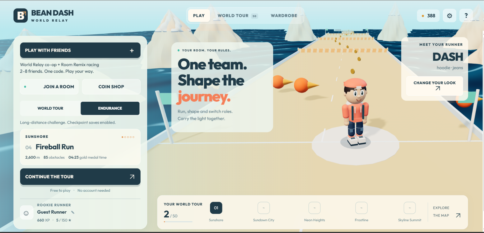

# Bean Dash Online · World Relay

[](https://github.com/IntelliCoder-AI/bean-dash-online/actions/workflows/test.yml)

**Your friends control the crossing. At the next beacon, it's your turn.**

[Play now](https://bean-dash-online.vercel.app/) · [Render backup](https://bean-dash-online.onrender.com/) · [Latest release](https://github.com/IntelliCoder-AI/bean-dash-online/releases/latest)



*Captured from the actual 3D game in a staged local session; interface/sign overlays are hidden for the cover.*

## Play with friends

1. Choose **Play with friends → Create World Relay**. Share the room code or invite link.
2. Friends join from their browsers. The host chooses **Runner** or **Shaper**, then starts.
3. Runners collect blue crystals and both gold seals, jumping barriers and dodging moving sentinels. Shapers time the bridge (8s), gate (7s) and wind (9s) using **1–3** or the labelled buttons. The final island adds a rescue lift (**4**, 6s).
4. Bring every Runner to each beacon. Roles rotate, routes change, and everyone wins together by beating the **120-second storm**. Interactive practice comes first; falls recover for free. Repeat machinery cycles cost no extra energy. Brief disconnections reserve your place for 45 seconds and automatically restore the same expedition.

WASD / arrows move Runners; Space jumps; Shift dives. Phones show touch controls. Drag to look around, scroll to zoom, and C resets the camera. No player login, installation or real-money purchases. Built with **ChatGPT Work** through iterative design, player feedback and testing.

## More ways to play

- **Room Remix:** 2–8 friends race on short courses, vote on hazards and rematch with the same code.
- **World Tour:** 50 solo levels, medals and separate Hardcore records.
- **Endurance:** long runs reaching 60 km, checkpoint saves and capped revival prices.
- **Competitive races:** up to 16 runners, with labelled bots filling empty slots.
- **Wardrobe & shop:** modular runners, cosmetics and earned coins; purchased gameplay powers stay solo.

[Relay rules](docs/WORLD_RELAY.md) · [Player guide](docs/GAME_GUIDE.md) · [Submission kit](docs/SUBMISSION.md)

## Development

Requires Node.js 22 or later. Maintained browser source is in `dist/`; the authoritative WebSocket server is in `server/`.

```sh
npm ci
npm test
npm start
```

Open http://localhost:3000. `npm run build:vercel` builds the static frontend. [Contributing](CONTRIBUTING.md) describes browser and balance checks. Tagged releases publish only after automated tests and the production build pass.

Vercel serves the frontend; Render hosts shared online rooms. Free Render cold starts and restarts remain possible. Bounded judging-week health checks run through 6 November 2026 and are best effort. Rooms are temporary. Guest saves stay in each browser and are separate between the two domains; clearing site data removes that save. WebGL is required. Automated viewport tests do not certify physical devices, Safari or real-GPU performance.

[Changelog](CHANGELOG.md) · [Deployment](docs/DEPLOYMENT.md) · [Security](SECURITY.md) · [Third-party notices](THIRD_PARTY_NOTICES.md) · [Roadmap](ROADMAP.md)
